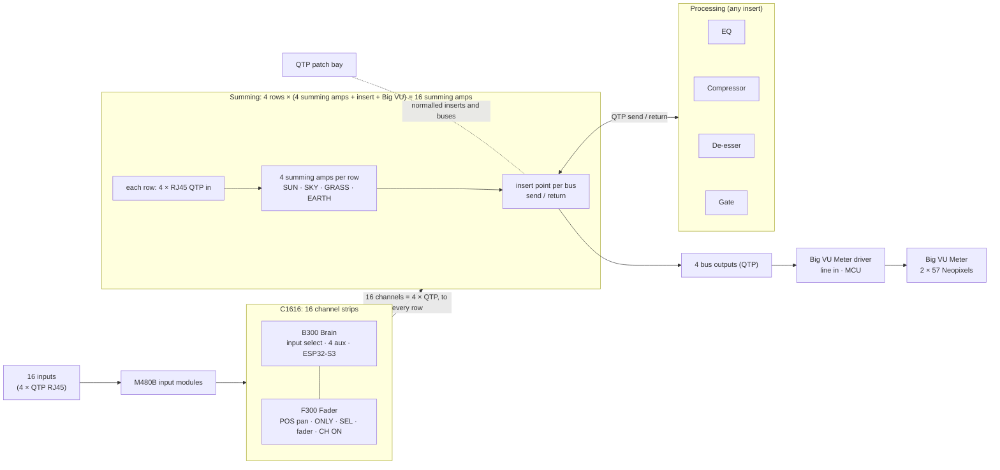
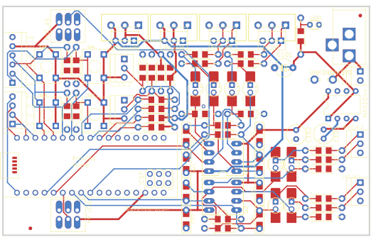
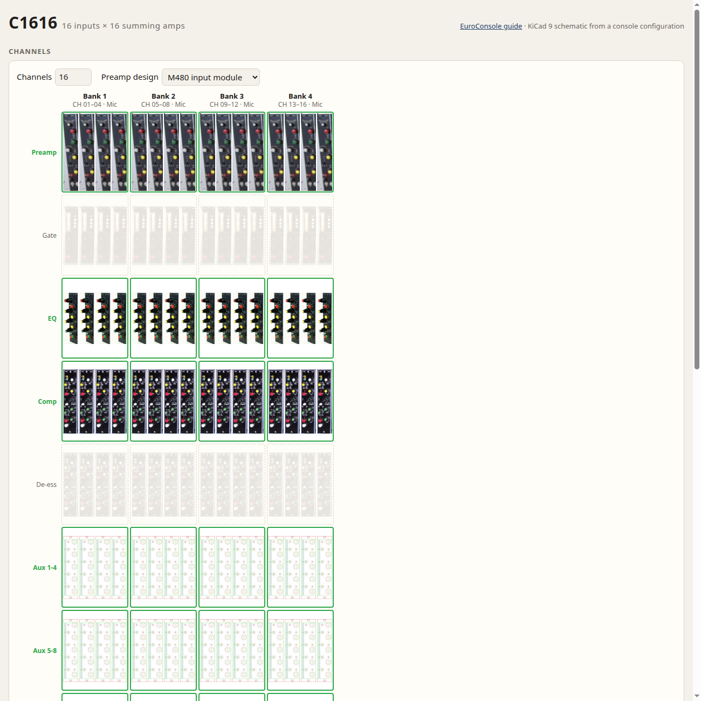
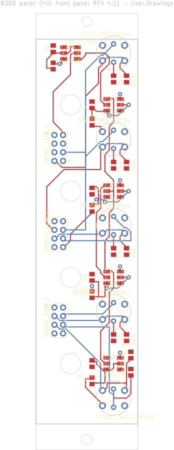
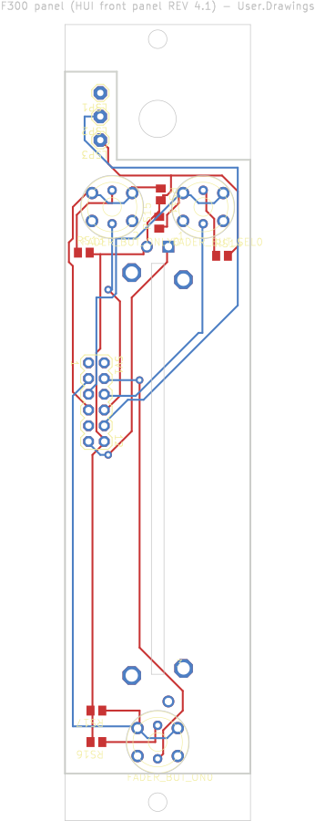
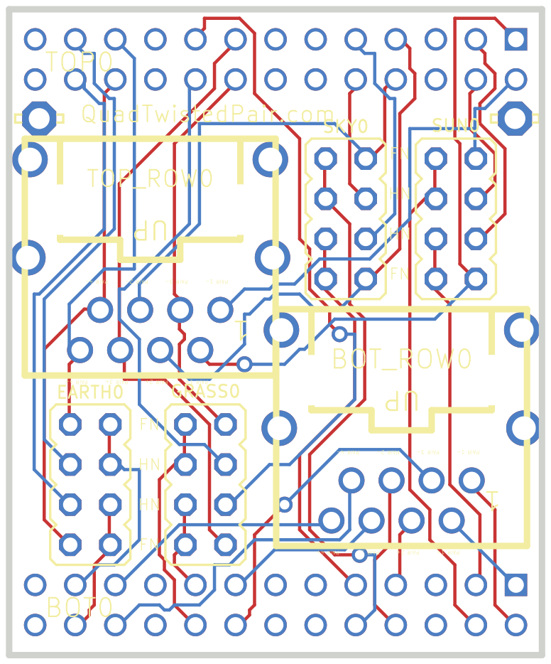

# EuroConsole

**A modular analog mixing console in Eurorack: Ward-Beck Systems circuits, digitally controlled, wired with Quad Twisted Pair.**

**Start here:** [`index.html`](index.html) walks through the whole console step by step. [`EDITOR/index.html`](EDITOR/index.html) builds your configuration as a KiCad schematic.

EuroConsole grows out of the 2016|49 *Digitally Controlled Analog Surround Sound Panner* (DCASSP), built at APK audio and Ward-Beck Systems as a Seneca College technology project. That prototype showed one idea: **the audio stays analog, the controls go digital**. Every control a mixer touches (encoders, buttons, faders, LEDs) is read by a microcontroller. The microcontroller sets digitally controlled analog parts, such as the Maxim DS1882 log-taper audio potentiometers, which do the actual work on the signal. Because the panel never carries audio, the controls can move, light up, recall and be driven remotely, and the signal path keeps the sound of the Ward-Beck circuits.

EuroConsole turns that prototype into a whole console, built from 3U Eurorack modules. The first build is the **C1616**:

| Part | What it is |
|---|---|
| **C1616 console** | 16 input channels (B300 Brain + F300 Fader strips) feeding **16 summing amplifiers**, in 4 rows of 6 modules |
| **Input** | M480B input module: the channel's mic/line front end |
| **4-input summing console** | one row: 4 × RJ45 QTP in (all 16 channels) → 4 summing amps, each with an insert point |
| **Processing** | EQ, compressor, de-esser, gate: patch into any insert |
| **Patch bay** | QTP patch bay module: inserts and buses on RJ45, normalled through |
| **Big VU Meter** (RD87) | the console's meter: the RD87 stereo Neopixel LED tower and its driver (REV 5, 2021\|54), plus moving-coil VU panels |

Everything connects with **QTP (Quad Twisted Pair)**: four balanced analog channels on one RJ45 / CAT5e cable, in the colour order **SUN, SKY, GRASS, EARTH**.


---

## How it fits together



### Signal rules

- **Audio is analog and balanced end to end**: THAT 1246 line receivers in, THAT 1646 line drivers out. The 2016|49 prototype used these on every board.
- **Control is digital**: one ESP32-S3 per channel strip reads the panel and sets the gain parts. The modules talk to each other over I2C on the Eurorack bus, and the console talks to the outside world over the network. The 2016|49 prototype used Ethernet and the HUI protocol, run from an Arduino Mega.
- **Every interconnect is QTP**: one RJ45 carries four channels, so 16 outputs need only four cables. A QTP pair is also the insert send / return.

---

## 1. The C1616 console (16 × 16): channel strip = B300 + F300

**C1616** = 16 input channels × 16 summing amplifiers.

Each channel strip is two 6HP × 3U modules from the *HUI front panel REV 4.1* drawing ([DXF](MECHANICAL/HUI%20front%20panel%20REV%204.1.dxf)):


| B300 **Brain** (left) | F300 **Fader** (right) |
|---|---|
| INPUT LED and SEL button | **POS** encoder: position in the surround field (L · C · R · Ls · Rs) |
| SUN / SKY / GRASS / EARTH: four auxiliary controls, each with an encoder, a Neopixel and a push-button | **ONLY**: solo, isolate and cue |
| carries the channel's microcontroller | **SEL**: select, which draws attention to the channel |
| | 60 mm linear **fader** (Bourns PTA6043): channel level |
| | **CH ON**: channel on |

**Panning (from the 2016|49 theory of operation).** The POS encoder indexes a table of DS1882 settings, one per speaker, at 1 dB per step. Each speaker peaks at 63–64 steps, and neighbouring speakers cross at 48 steps (16 dB down):

```
{64,0,0,0,0} {48,48,0,0,0} {0,63,0,0,0} {0,48,48,0,0} {0,0,63,0,0} {0,0,48,48,0} {0,0,0,64,0} {0,0,0,48,48} {0,0,0,0,63}
```

The fader scales the looked-up row to a percentage. At power-up, every pot starts at full mute.

**C1616.** 16 input channels feed 16 summing amplifiers. The 16 channels leave the strips on four QTP cables (4 channels each), and every summing row receives all four. 16 strips × 12HP = 192HP, which is three rows of 84HP.

---

## 2. Summing: 4 rows of 6 = 16 summing amplifiers

The summing side is **4 rows of 6 modules**. Each row is one **4-input summing console**:

| Slot | Module |
|---|---|
| 1–4 | **summing amplifiers**: the row's four buses, SUN · SKY · GRASS · EARTH. All 16 channels arrive on the row's 4 × RJ45 QTP inputs |
| 5 | **insert / patch**: an insert send / return for each of the row's four buses (QTP) |
| 6 | **Big VU (RD87)**: meters the row's four buses |

4 rows × 4 = **16 summing amplifiers**: 16 inputs × 16 summing buses. Each bus has an **insert point** and leaves on a QTP output. *Slots 5 and 6 are provisional; the layout of 4 summing amps + 2 per row is set.* Big VU REV 5 shows two bars, so the row needs a 4-bar version, or two towers.

- **Summing amplifier:** Ward-Beck [M450](https://github.com/WardBeckSystems/MODULES.AMPLIFIERS.M450-Program-Summing-Amplifier) / [M450A](https://github.com/WardBeckSystems/MODULES.AMPLIFIERS.M450A-Program-Summing-Amplifier) / [M450B](https://github.com/WardBeckSystems/MODULES.AMPLIFIERS.M450B-Program-Summing-Amplifier) program summing amplifiers (Rodger Beck, 1975|8–1979|12). The 2016|49 prototype summed through 2 × 4 M450A cards. Also [M484 Dual Summing Amplifier](https://github.com/WardBeckSystems/MODULES.SUMMING.M484-Dual-Summing-Amplifier).
- **QTP backplane:** **QTP-BAC 14.1** (in `KICAD/`) is the four-channel QTP board, with RJ45s, transformers, XLR and BNC for SUN/SKY/GRASS/EARTH. It is the starting point for the summing console's input/output board.
- **Insert points:** a balanced send and return per bus, switched in or out. The model is the [M499 Insertion Switcher](https://github.com/WardBeckSystems/MODULES.UNSORTED.M499-Insertion-Switcher), plus the 1979|12 *M466N Insert Meter Module* drawing ([M466](https://github.com/WardBeckSystems/MODULES.DYNAMICS.M466-Limiter-Compressor-Module)). *Proposed:* sends on one RJ45 and returns on another, with QTP pairs 1–4 = buses 1–4, so one cable pair inserts a processor into all four buses.

---

## 3. Input: M480B

The [M480B input module](EAGLE/2021-APK/M480B%20Input%20module.sch) is the channel front end ahead of the B300/F300 strip. APK redrew it in Eagle in 2021|54 from the Ward-Beck original: LM201 op-amps, a MAT-01 matched pair and discrete output transistors (255 parts).

## 4. Processing: EQ, compressor, de-esser, gate

Each processor is a Eurorack module with QTP send / return, so it patches into any insert. Each one starts from a Ward-Beck circuit already drawn in this archive. Three already exist as 2021|54 APK Eagle redraws in [EAGLE/2021-APK](EAGLE/2021-APK/):

| Function | Starting from | Eagle (2021\|54 APK) | KiCad in the archive |
|---|---|---|---|
| **EQ** | [M462B Effects Equalizer](https://github.com/WardBeckSystems/MODULES.FILTERS.M462B-Equalizer-Module); also [M462](https://github.com/WardBeckSystems/MODULES.FILTERS.M462-Equalizer-Module), [M472](https://github.com/WardBeckSystems/MODULES.FILTERS.M472-Equalizer-Module) / [M472A](https://github.com/WardBeckSystems/MODULES.FILTERS.M472A-Stereo-Equalizer-Module) | `M462B Final.sch` (356 parts) | M462 27 · M462B 10 · M462C 11 · M472 14 · M472A 7 sheets |
| **Compressor** | [M466 Limiter-Compressor](https://github.com/WardBeckSystems/MODULES.DYNAMICS.M466-Limiter-Compressor-Module) (1976\|9): signal path, 6-106 control amplifier, output amplifier | `M466-compressor-limiter.sch` (315), `M466 - Control amp.sch` (114) | M466 15 · [M466M](https://github.com/WardBeckSystems/MODULES.DYNAMICS.M466M-Compressor-Meter-Module) 3 |
| **Output amplifier** (EQ and compressor) | the M466 / M462B output stage: LM201 and 4 complementary pairs | `M466 and M462B Output Amplifier.sch` (87) | in M466 |
| **De-esser** | M466 with a frequency-weighted (high-pass / band-pass) side-chain into its control amplifier | — | new circuit, based on M466 |
| **Gate** | [M467 Noise Gate and Meter Module](https://github.com/WardBeckSystems/MODULES.DYNAMICS.M467-Noise-Gate-and-Meter-Module) | — | M467 8 |

The front panels follow the B300/F300 language: encoders with Neopixels and POD buttons. The processor's ESP32-S3 sets its thresholds and gains through digitally controlled parts.

## 5. Patch bay

The **QTP patch bay module** puts every insert send / return and bus on RJ45, normalled through, so processors patch in with one CAT cable per four channels. It starts from **QTP-BITTREE PATCHBAY REV 2.1** (2021|54, Gerbers marked "good to go"): a 34 × 41 mm card with a top-row and bottom-row QTP RJ45, plugging into a Bittree patchbay connector, so a Bittree bay becomes a QTP bay. A sibling, **QTP-NEUTRIK D-hole** (24 × 27 mm), mounts a QTP RJ45 in a standard Neutrik D-hole for panels.

## 6. Metering: the Big VU Meter (RD87)

Big VU is Ward-Beck R&D project **RD87**, the *RD87 LED tower* (2015|48): a free-standing stereo level tower. Product repo: [PRODUCTS.BigVU](https://github.com/WardBeckSystems/PRODUCTS.BigVU). Page: [WBSps.ca Big VU](https://WBSps.ca/2026/PAGES/Big-VU.html). Simulator: [Big VU](https://WBSps.ca/2026/siumulation.html?plugin=bigvu), with front panel, tutorial, block diagram and firmware trace. In EuroConsole it is the console's meter bridge: one tower per bus pair, fed from the bus outputs.




- **VU meter driver + meter: Big VU Meter REV 5** (2021|54, 102 × 64 mm). A dual op-amp line input feeds an Arduino Micro, which drives two Neopixel bars of 57 pixels each (left / right). Two WBS 10-080 pots set the ceiling. The firmware ([SOFTWARE/BIG_VU_METERS_arduinopro_mini.ino](SOFTWARE/BIG_VU_METERS_arduinopro_mini.ino), 2015|48) adds a log scale, calibration and two falling peak dots. This is the driver to move to Eurorack and the ESP32-S3.
- **Moving-coil VU meters**, one per bus, as in the 2016|49 prototype (five WBS meters, each with a 15 dB calibration pad): [M435 VU Meter](https://github.com/WardBeckSystems/MODULES.METER.M435-VU-Meter), driven by an [M405 Extended Range VU Meter](https://github.com/WardBeckSystems/MODULES.METER.M405-Extended-Range-VU-Meter) / [M445](https://github.com/WardBeckSystems/MODULES.METER.M445-Extended-Range-Meter) stage (+4 dBu = 0 VU).

---

## Console editor: configuration → KiCad schematic

[`EDITOR/index.html`](EDITOR/index.html) is an interactive page that builds a specific console and writes its KiCad 9 schematic. Open it in a browser; it works offline from the file.



- **Every Eurorack module is a bank of 4 channels** (one QTP in, one QTP out, SUN · SKY · GRASS · EARTH): 4 preamps, 4 gates, 4 EQs, 4 compressors, 4 de-essers, Aux 1-4 / Aux 5-8 / M 1-4 send banks and 4 faders. The console view shows one column per bank, modules top to bottom with real faces; click to add or remove a module for the bank, or a row name for every bank. The preamp design is a choice (M480 for now, M480B or M460). The schematic has one sheet per bank.
- **Summing rows:** each summing amp is a bus named by what it sums: M1–M4, AUX1–AUX8, then direct sums (BUS13…). The C1616 is rows M1–4 · AUX1–4 · AUX5–8 · BUS13–16, each with insert and Big VU. The name follows the configuration: 16 inputs × 16 summing amps = **C1616**.
- **Download:** a zip of a hierarchical KiCad 9 project: a root sheet, a channels sheet and one sheet per summing row. It includes `EuroConsole.kicad_sym` and `sym-lib-table`, plus the configuration (JSON, which *Load config* reads back) and a parts list (CSV).
- **Symbols:** the Ward-Beck modules use the archive's own symbols (`2026/Engineering/KICAD`: M480B, M450, M499, M462B, M466, M467), with their real card-edge pins. QTP RJ45, XLR, the B300/F300 strip and the RD87 Big VU are EuroConsole parts. Run `python3 EDITOR/build_symbols.py` to refresh `symbols.js`.
- **Nets** are global labels shared by every sheet: `IN` (XLR), `FS`/`FR` (M480B fader send / return through the strip), `CH` (channels on QTP), `SUMN` (summing nodes), `SEND`/`RET` (inserts), `BUS` (bus outputs) and `P<ref>_` (processor patch points). QTP pairs are SUN 2/1 · SKY 4/5 · GRASS 6/3 · EARTH 8/7, with the shell to GND.
- **Tested:** `node EDITOR/test_generator.js` generates the C1616, has `kicad-cli` load it, and checks the netlist. Each summing node has its 16 resistors plus the M450 input; each channel reaches its 16 resistors and all four rows. ERC leaves only "power pin not driven" (the schematic has no supply). The archive's M462B, M466 and M467 symbols give left and right the same pin numbers, so ERC reports duplicate pins when those modules are placed.

## Boards in this repo

`KICAD/` holds KiCad 9 boards converted from the Eagle designs in `EAGLE/` with [`tools/eagle2kicad_pcb.py`](https://github.com/WardBeckSystems/WBSps.ca/blob/main/tools/eagle2kicad_pcb.py). `KICAD/split_boards.py` splits the combined 2016|49 Eagle sheet into one board per module. Each board is placed in its panel's coordinates, with the panel drawing on *User.Drawings*.

| Board | From | Size | Parts | Panel check |
|---|---|---|---|---|
| `B300_Front` | 2016\|49 Encoder PCB 17.2 | 30 × 113.6 mm | 37 | all 14 controls within 0.18 mm of their panel holes (4 Neopixels + INPUT LED, 4 encoder holes, 5 buttons) |
| `F300_Fader` | 2016\|49 Encoder PCB 17.2 | 30 × 113.6 mm, L-shape | 14 | ONLY, SEL and CH ON within 0.01 mm; the fader's 4 mounting pads within 0.02 mm of the panel screws; the POS encoder mounts on the panel above the notch |
| `B300_Main` | 2016\|49 Encoder PCB 17.2 | 133.8 × 113.4 mm | 27 | perpendicular side board: 4 encoders (WBS 10-081), Arduino Mega, RS-485, DB9, DS1808 |
| `Maxim_Adapter_Board` | 2016\|49 Maxim Adapter Board | 20 × 25 mm | 3 | DS1882 breakout (also on the Encoder sheet) |
| `QTP-BAC_14.1` | 2016\|49 | 114 × 50 mm | 112 | four-channel QTP backplane: RJ45, transformers, XLR, BNC |
| `Big_VU_Meter_REV5` | 2021\|54 APK | 102 × 64 mm | 84 | stereo Neopixel VU meter and driver |
| `QTP-BITTREE_Patchbay_REV2.1` | 2021\|54 APK | 34 × 41 mm | 10 | QTP card for a Bittree patchbay |
| `QTP-NEUTRIK_D-hole` | 2021\|54 APK | 24 × 27 mm | 7 | QTP RJ45 in a Neutrik D-hole |
| `Encoder_PCB_17.2` | 2016\|49 | — | 221 | the whole Eagle sheet, kept as the source |

| B300 Front | F300 Fader | Big VU Meter | QTP Bittree patchbay |
|---|---|---|---|
|  |  |  |  |

**Schematics.** The Eagle `.sch` files (M480B, M462B, M466, the output amplifier, the VU meter, the patchbay, and the 2016|49 DCASSP sheets) still need KiCad's GUI importer: File → Import → Non-KiCad Schematic. The 2016|49 schematics are also in [MANUALS/2016 - DCASSP schematics V1.pdf](MANUALS/2016%20-%20DCASSP%20schematics%20V1.pdf).

## Roadmap

1. **B300 / F300 for Eurorack**: replace the Arduino Mega side board with an ESP32-S3 on the B300, and connect the F300 by ribbon. Use the Eurorack 16-pin power header (±12 V, regulated to ±7 V for the DS1882 analog rails). Connect modules over I2C.
2. **Input**: M480B as a Eurorack input module.
3. **Summing console**: a 4 × QTP input board from QTP-BAC, an M450-style summing amplifier per bus, and an insert send / return per bus.
4. **Processing**: EQ (M462B), compressor (M466), de-esser (M466 side-chain), gate (M467). Each gets a Eurorack PCB and panel with QTP send / return, sharing the M466/M462B output amplifier.
5. **Patch bay**: QTP-BITTREE and QTP-NEUTRIK into a Eurorack QTP patch module, normalled.
6. **Metering**: Big VU Meter onto the ESP32-S3 as the VU meter driver, plus moving-coil VU panels.
7. **The C1616 frame**: three 84HP rows, the power, the QTP patch, and network control.

## Source material

| Folder | What |
|---|---|
| [EAGLE/2016-DCASSP](EAGLE/2016-DCASSP/) | Encoder PCB 17.2, QTP-BAC 14.1, Maxim (DS1882) adapter, VU meter and summing amp, block diagram |
| [EAGLE/2021-APK](EAGLE/2021-APK/) | M480B, M462B, M466, M466 control amp, M466/M462B output amp, Big VU Meter REV 5, QTP-BITTREE patchbay, QTP-NEUTRIK D-hole |
| [GERBERS/](GERBERS/) | QTP-BITTREE PATCHBAY REV 2.1 ("good to go") |
| [SOFTWARE/](SOFTWARE/) | Big VU meter firmware (Arduino, Neopixel) |
| [MANUALS/](MANUALS/) | 2016\|49 DCASSP final report (TPJ655) and schematics |
| [MECHANICAL/](MECHANICAL/) | HUI front panel REV 4.1 (DXF and render), Bourns PTA6043 fader |
| [PHOTOS/](PHOTOS/) | HUI prototype cross reference |

---
© Ward-Beck Systems (Ward-Beck.com - Ward-Beck.ca) · DCASSP design and archive by Anthony Peter Kuzub · [WBSps.ca](https://WBSps.ca) · [WBSps.Kuzub.com](https://WBSps.Kuzub.com)
